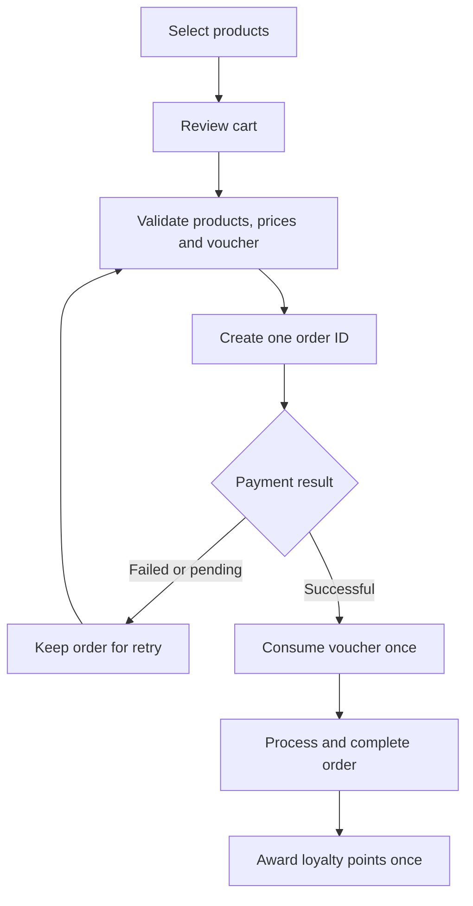
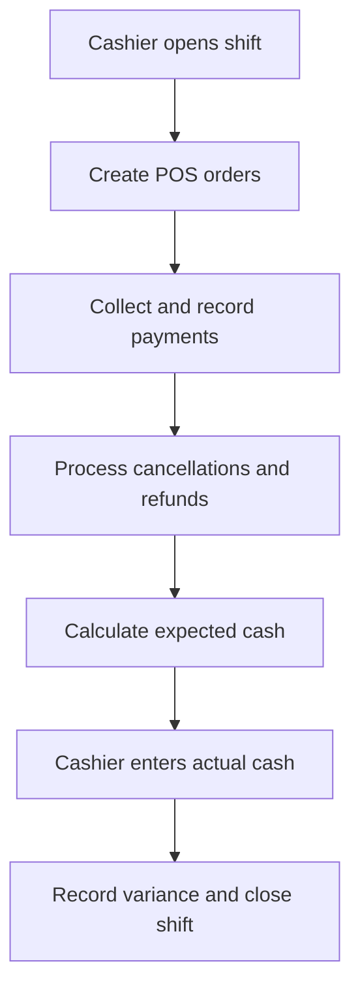

# Blossom Brew Ordering and Membership Management System

> Business Analysis case study for a web-based ordering, point-of-sale, loyalty, and store operations platform.

## Project Overview

Blossom Brew is a self-initiated Business Analysis case study developed around a working web application for a coffee shop. The project demonstrates how a business problem can be translated into scope, business rules, functional requirements, use cases, interface behavior, and validation scenarios.

The solution supports four user roles:

- **Guest** — browses the public menu, registers an account, views public announcements, and submits a support request.
- **Customer** — places pickup orders, uses vouchers, tracks orders, earns and redeems loyalty points, submits reviews, and manages personal information.
- **Cashier** — creates POS orders, serves members or walk-in customers, processes store orders, and opens and closes a cash shift.
- **Admin** — manages products, orders, members, vouchers, cashier accounts, shifts, notifications, support requests, reviews, and reports.

## Project Snapshot

| Item | Description |
| --- | --- |
| Domain | Food and beverage, e-commerce, POS, and loyalty management |
| Project type | Self-initiated Business Analysis case study and working prototype |
| Primary role | Business Analyst |
| Delivery approach | Requirements-driven and iterative |
| Main users | Guest, Customer, Cashier, and Admin |
| Core BA outputs | BRD, 29 use cases, business rules, role-permission matrix, acceptance criteria, traceability, and validation scenarios |
| Product status | Functional prototype; payment, refund, OTP, and email interactions are simulated |

## Business Problem

Blossom Brew's assumed current process relies heavily on direct ordering and manual operational records. This creates several business issues:

- Order information can be incomplete or inconsistent.
- Online and counter orders are difficult to manage in one place.
- Loyalty points and vouchers are difficult to track manually.
- Cash collected during each cashier shift is difficult to reconcile.
- Managers have limited visibility into sales, product performance, members, and promotions.
- Customer support, reviews, and operational notifications are fragmented.

This current-state assessment is part of a portfolio case study and has not yet been validated through field research with a real coffee shop.

## Business Objectives

The proposed solution aims to:

1. Improve the pickup ordering experience for customers.
2. Standardize POS and order-processing activities at the counter.
3. Centralize order, payment, member, voucher, and shift information.
4. Introduce a traceable loyalty program with clear earning and redemption rules.
5. Give administrators operational reports and controls for day-to-day management.
6. Enforce role-based access and protect each user's permitted data.

## Scope

### In Scope

- Public menu and product details
- Customer registration, authentication, and profile management
- Online pickup ordering and simulated payment
- Shopping cart, product options, voucher application, and payment retry
- Customer order history and cancellation
- Loyalty points, membership tiers, and personal vouchers
- POS ordering for members and walk-in customers
- Cashier shift opening, closing, and cash reconciliation
- Product, order, member, voucher, and cashier-account administration
- Product reviews and customer support requests
- Role-based announcements and personal notifications
- Dashboard, period reports, and CSV export

### Out of Scope

- Real payment-gateway and bank reconciliation integration
- Third-party delivery
- Raw-material inventory, suppliers, and purchasing
- Advanced CRM and omnichannel marketing
- Production email, SMS, or OTP delivery
- Automatic membership-period reset policies

## My Role and Responsibilities

As the Business Analyst for this case study, I:

- Analyzed the business context, current-state problems, and target outcomes.
- Defined the project scope, assumptions, dependencies, and exclusions.
- Identified stakeholders, user roles, goals, and access boundaries.
- Modelled current-state and future-state business processes.
- Documented business, functional, and non-functional requirements.
- Defined business rules for orders, payments, vouchers, loyalty points, shifts, reviews, support, and notifications.
- Produced detailed use cases with preconditions, main flows, alternative flows, exceptions, and outcomes.
- Established acceptance criteria and requirement identifiers for traceability.
- Reviewed interface behavior against business requirements.
- Defined validation scenarios for critical workflows and exception cases.
- Recorded unresolved decisions instead of silently making unsupported business assumptions.

## Business Analysis Approach

| Stage | Key Activities | Main Outputs |
| --- | --- | --- |
| Discover | Analyze the business context, users, pain points, and desired value | Business background, problem statement, objectives |
| Define | Establish scope, stakeholders, assumptions, and boundaries | Scope statement, stakeholder list, role-permission matrix |
| Analyze | Break down processes, rules, states, exceptions, and data needs | Business rules, process flows, state logic, decision log |
| Specify | Translate business needs into testable solution requirements | BRD, functional and non-functional requirements, use cases |
| Design support | Connect requirements to interface behavior and user journeys | Screen behavior, workflow references, prototypes |
| Validate | Review requirement consistency and test end-to-end outcomes | Acceptance criteria, traceability, business test scenarios |

## Key Business Decisions

### 1. Separate Available Points from Tier-Qualifying Points

The loyalty model separates two values:

- **Available points** can be exchanged for personal vouchers.
- **Tier-qualifying points** determine the member's current tier.

Redeeming a voucher reduces available points but does not reduce tier-qualifying points or immediately downgrade the member. This prevents the customer from being penalized for using earned rewards.

**Example:** A Silver member has 60 available points and 60 tier-qualifying points. After redeeming 20 points, the available balance becomes 40, while the tier-qualifying balance remains 60 and the member stays Silver.

### 2. Retry Payment on the Same Order

If a simulated online payment fails, the system retains the existing order instead of creating a duplicate. Before retrying, the system revalidates product availability, price, and voucher eligibility. If the payable amount changes, the customer must confirm the new total.

This decision reduces duplicate orders, duplicate voucher usage, and accidental loyalty-point awards.

### 3. Consume Benefits Only After Successful Payment

A voucher usage is recorded only after payment succeeds. Loyalty points are awarded once, only when the order is both paid and completed. If an eligible paid order is cancelled, the system records a simulated refund and restores the consumed voucher according to its type.

### 4. Reconcile Cash by Cashier Shift

A cashier must open a shift before creating POS orders. Expected cash is calculated as:

```text
Expected cash = Opening cash + Cash collected during the shift - Cash refunds during the shift
Variance = Actual closing cash - Expected cash
```

Cash already collected remains part of the till even when the related order is still being prepared. Closing a shift records the actual amount and variance immediately; it does not wait for an administrator's approval.

### 5. Enforce Permissions at the Service Layer

Hiding a button is not treated as authorization. Access rules are checked when data is requested or changed:

- Customers access only their own personal data and orders.
- Cashiers process only the store operations within their assigned scope.
- Administrators manage operational and master data.
- Suspended accounts cannot continue protected actions.

## Core Business Workflows

### Online Order and Payment



### POS and Shift Reconciliation



## Requirements Highlights

| Requirement Area | Representative Rules and Behaviors |
| --- | --- |
| Accounts and access | Four roles with server-side authorization and personal-data boundaries |
| Menu | Only active products can be ordered; size and topping prices are validated by the system |
| Orders | At least one valid item and a payment method are required; order and payment statuses are separate |
| Payment retry | The same order ID is retained; price and voucher conditions are revalidated |
| Loyalty | Points are awarded once after paid completion; available and tier-qualifying points are separate |
| Vouchers | One voucher per order; ownership, dates, usage limits, tier, and minimum value are validated |
| POS | A cashier needs an open shift; member and walk-in transactions are supported |
| Shifts | Opening cash, expected cash, actual cash, refunds, and variance are recorded |
| Reviews | A customer can review each purchased product once per completed order |
| Support | Requests cannot be withdrawn after submission; responses remain visible only to the permitted user |
| Notifications | Announcements and personal notifications follow recipient and role rules |
| Reporting | Revenue, completed orders, average order value, payment methods, products, members, and vouchers are summarized |

## Role and Permission Summary

| Capability | Guest | Customer | Cashier | Admin |
| --- | :---: | :---: | :---: | :---: |
| Browse menu | Yes | Yes | Yes | Yes |
| Register a customer account | Yes | No | No | No |
| Place an online order | No | Yes | No | No |
| Create a POS order | No | No | Yes | Yes |
| View personal order history | No | Yes | No | No |
| Process store orders | No | No | Yes | Yes |
| Earn or use member benefits | No | Yes | At POS | Manage |
| Open and close a cashier shift | No | No | Yes | No |
| Submit a support request | Yes | Yes | Yes | No |
| Manage master and operational data | No | No | No | Yes |
| View management reports | No | No | Shift metrics | Yes |

## Requirements Traceability Example

The project uses identifiers to connect business intent to solution behavior and validation evidence.

| Business Rule | Use Case | Validation Scenario | Expected Result |
| --- | --- | --- | --- |
| Available and tier points are independent | UC-11, UC-12 | Redeem 20 points from a Silver member with 60 points | Available points become 40; tier points remain 60; tier remains Silver |
| Failed payment retains the order | UC-08 | Retry after a failed payment | The order ID is unchanged and no duplicate order is created |
| Voucher is consumed once | UC-08, UC-10 | Repeat a successful payment or cancellation request | Usage and restoration are applied no more than once |
| Cash collected belongs to the shift | UC-19, UC-24 | Close a shift while a paid order is still being prepared | Collected cash is included in expected cash |
| Product reviews require a completed purchase | UC-13 | Review an unpurchased or incomplete-order product | The request is rejected without creating a review |

## BA Deliverables

The portfolio package is designed to include:

| Deliverable | Purpose |
| --- | --- |
| Business Requirements Document | Defines business context, objectives, scope, stakeholders, rules, requirements, and acceptance criteria |
| Use Case Specification | Describes 29 user goals with preconditions, main flows, alternatives, exceptions, and traceability |
| Role-Permission Matrix | Clarifies access boundaries across Guest, Customer, Cashier, and Admin |
| Current-State and Future-State Analysis | Shows the operational problems and the proposed process changes |
| Business Rules Catalogue | Centralizes order, payment, voucher, loyalty, shift, review, support, and notification rules |
| Requirements Traceability Matrix | Connects objectives, requirements, use cases, screens, and test scenarios |
| Business Validation Scenarios | Verifies critical end-to-end behavior and exception handling |
| Working Prototype | Demonstrates how documented requirements are represented in the product |

## Open Decisions and Assumptions

The analysis keeps unresolved policy decisions visible for stakeholder confirmation, including:

- Exact account-verification and password-recovery policies
- Permitted order-status transitions and cancellation cut-off points
- Treatment of loyalty points when a completed order is later cancelled
- Voucher value, validity, and policy-effective dates for point redemption
- Treatment of refunds posted after a cashier shift has closed
- Reporting time zone, date basis, rounding, and ranking rules
- Event-to-recipient mapping for operational notifications
- Archival rules for accounts, products, vouchers, and historical transactions
- Production service levels, session policy, backup, retention, and recovery requirements

Keeping these items open prevents assumptions from being misrepresented as approved business policy.

## Validation Strategy

Validation focuses on business outcomes rather than screen clicks alone:

- Confirm that each role can access only its permitted functions and data.
- Test main, alternative, exception, retry, and duplicate-request flows.
- Verify order and payment states independently.
- Recalculate product price, discounts, voucher conditions, and points on the service side.
- Confirm that a restart does not lose orders, members, vouchers, shifts, or history.
- Verify that cancellation and retry actions do not create duplicate financial or loyalty effects.
- Check that reports use the agreed order status, payment status, and date basis.

Example project checks:

```bash
npm test
npm run build
node scripts/verify-artifact.mjs
node scripts/verify-local-http.mjs
```

## Solution Overview

The working prototype uses:

- React and React Router for the user interface
- Vite for local development and production builds
- Node.js services for business operations and authorization
- SQLite for local business data
- Supabase for authentication in the separated environment configuration
- Drizzle ORM schema and migrations for the cloud-oriented data model

Technical implementation is included as evidence that the requirements can be demonstrated. The primary focus of this repository remains the Business Analysis process and the traceability from business need to validated behavior.

## Run the Prototype Locally

### Prerequisites

- Node.js 24 or later
- npm

### Installation

```bash
npm ci
npm run dev
```

Open `http://localhost:5173`.

### Sample Accounts

| Role | Email | Password |
| --- | --- | --- |
| Customer | `customer@blossombrew.vn` | `Customer123` |
| Cashier | `cashier@blossombrew.vn` | `Cashier123` |
| Admin | `admin@blossombrew.vn` | `Admin123` |

These credentials are for local demonstration data only. Do not enter real payment-card, bank-account, or personal information into the prototype.

## Limitations

- The business context and process assumptions require validation with real store owners, cashiers, and customers before production use.
- Payments, refunds, OTP, and outbound email are simulations.
- The prototype does not provide inventory, supplier, purchasing, or delivery-partner management.
- Production security, performance, availability, privacy, backup, and compliance requirements require further analysis and testing.

## What I Learned

This project reinforced that a useful BA deliverable must describe more than the successful path. The most important analysis involved state transitions, repeated requests, payment failures, concurrent point redemption, voucher restoration, cash reconciliation, and authorization boundaries.

It also demonstrated the importance of keeping the BRD, use cases, interface behavior, business rules, and test evidence synchronized when a policy changes.

## Repository Notes

- Only example environment files should be committed.
- Local environment files, databases, uploads, and secret keys must remain excluded from version control.
- The repository should not be presented as paid client work or as a production deployment.
- Any measured business impact should be added only after real-world validation.

---

This repository is presented as a Business Analyst portfolio case study. It demonstrates analysis and solution-validation capability; it does not claim stakeholder approval or production readiness.
